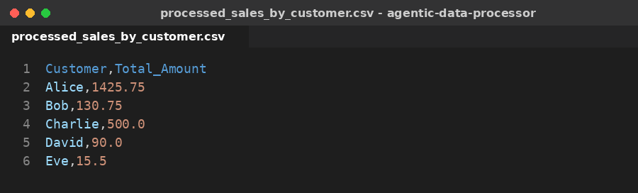
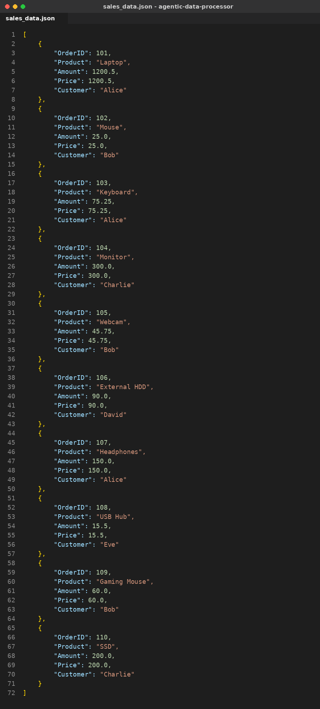
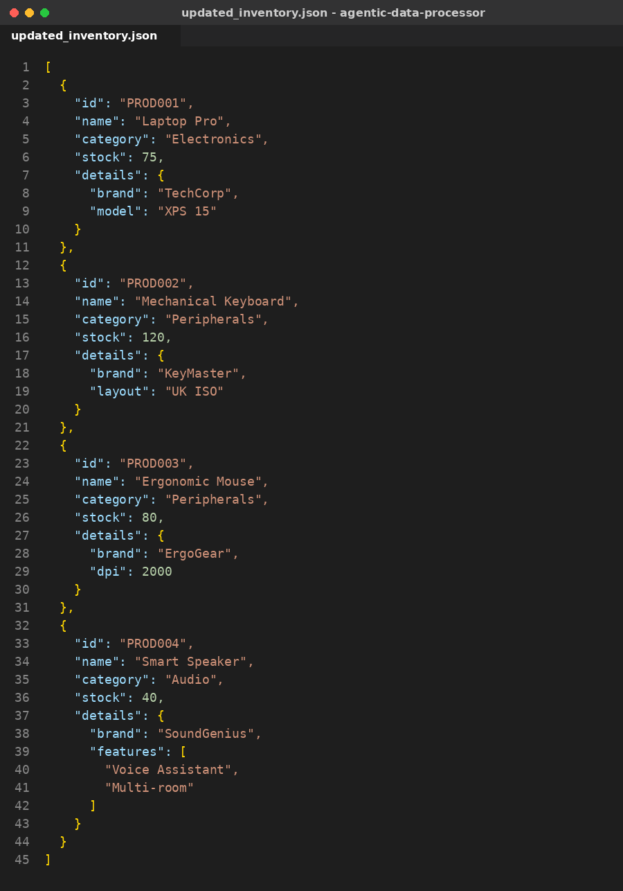

# LabX ADV: Agentic Data Processing (Advanced CSV & JSON Workflows)

**ชื่อ:** สาริษฐ์ บุตรช่วง  **รหัสนักศึกษา:** 663380365-3
**รายวิชา:** SP352301 Script Programming (1/2569)

โปรเจกต์นี้คือ "Agentic Data Processor" — `DataAgent` อ่าน pipeline จากไฟล์ `configs/data_pipeline_config.json`
แล้วรัน task ทีละขั้น ส่งข้อมูลระหว่าง task ผ่าน `data_store` (in-memory) และบันทึกทุกขั้นตอนลง audit report

## ผลลัพธ์ (Screenshots)

### 1. `data/processed_sales_by_customer.csv` — ยอดขายรวมแยกตามลูกค้า


### 2. `data/sales_data.json` — แปลงข้อมูลขายจาก CSV เป็น JSON (ตัวเลขถูกแปลงเป็น int/float)


### 3. `data/updated_inventory.json` — inventory หลังอัปเดต
- `PROD001` stock 50 → **75**
- `PROD002` layout `US ANSI` → **UK ISO**
- `PROD003` dpi 1600 → **2000**
- เพิ่มสินค้าใหม่ **PROD004 Smart Speaker**
- update `PROD001.details.color` ถูกข้าม (path ไม่ถูกต้องโดยตั้งใจ เพื่อทดสอบ error handling — มี warning ใน log)



## Pipeline (ตาม config)

| # | Task | Type | Input → Output |
|---|------|------|----------------|
| 1 | Load Sales Data CSV | `load_csv` | `input_sales.csv` → `raw_sales_data` |
| 2 | Aggregate Sales by Customer | `transform_csv_aggregate` | `raw_sales_data` → `customer_sales_summary` |
| 3 | Save Aggregated Sales CSV | `save_csv` | → `processed_sales_by_customer.csv` |
| 4 | Convert Raw Sales to JSON | `csv_to_json_conversion` | `raw_sales_data` → `raw_sales_json` |
| 5 | Save Raw Sales JSON | `save_json` | → `sales_data.json` |
| 6 | Load Inventory Data JSON | `load_json` | `input_inventory.json` → `raw_inventory_data` |
| 7 | Update Inventory Stock & Add Product | `update_json_data` | → `updated_inventory_data` |
| 8 | Query Specific Product Detail | `query_json_data` | `0.details.brand` → `TechCorp` |
| 9 | Save Updated Inventory JSON | `save_json` | → `updated_inventory.json` |

## สิ่งที่แก้จากโค้ดตัวอย่างในใบงาน

1. **`main.py`** – เปลี่ยนเป็น `from src.config_parser import ...` เพราะไฟล์ใน `src/` ใช้ relative import (`from .utils`) ถ้า import ตรง ๆ จะเกิด `ImportError: attempted relative import with no known parent package`
2. **`config_parser.py`** – ไม่บังคับ `output_data_key` สำหรับ `save_csv` / `save_json` (config ไม่มี key นี้ในงาน save)
3. **`csv_tasks.py` / `json_tasks.py`** – เพิ่ม import `ensure_directory_exists` ที่ขาดไป
4. **`json_tasks.py`** – `add_to_list` รองรับ path `""` (root เป็น list) เพื่อเพิ่ม PROD004 และเช็ค `path is None` แทน `not path`; ลบ `from turtle import update` ที่ไม่ได้ใช้ (ทำให้รันบนเครื่องที่ไม่มี GUI ไม่ได้)
5. **`data_agent.py`** – เพิ่ม `import sys` และให้หา base folder ได้แม้รันใน Colab (ไม่มี `__main__.__file__`)

## วิธีรัน

```bash
git clone https://github.com/sarid101/agentic-data-processor.git
cd agentic-data-processor
python main.py
```

ใช้แค่ไลบรารีมาตรฐานของ Python (`csv`, `json`, `logging`, `os`) ไม่ต้องติดตั้งอะไรเพิ่ม
หลังรันจะได้ไฟล์ใน `data/` และ audit report ใน `reports/audit_report_*.json`

## โครงสร้างโปรเจกต์

```
agentic-data-processor/
├── src/
│   ├── __init__.py
│   ├── data_agent.py          # ตัว agent: อ่าน config, dispatch task, จัดการ data_store
│   ├── csv_tasks.py           # load / save / aggregate / filter CSV
│   ├── json_tasks.py          # load / save / update / query JSON
│   ├── conversion_tasks.py    # CSV <-> JSON
│   ├── config_parser.py       # โหลดและตรวจสอบ config
│   └── utils.py               # logging, สร้างโฟลเดอร์, audit log
├── configs/
│   └── data_pipeline_config.json
├── data/
│   ├── input_sales.csv
│   ├── input_inventory.json
│   ├── processed_sales_by_customer.csv   # output
│   ├── sales_data.json                   # output
│   └── updated_inventory.json            # output
├── screenshots/                          # ภาพผลลัพธ์สำหรับส่งงาน
├── AllCode.md                            # รวมโค้ดทั้งหมด
├── main.py
├── .gitignore
└── README.md
```
